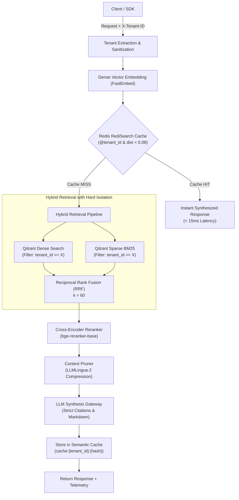

# IsoRAG: Architecture & Infrastructure Specification

## 1. System Overview

**IsoRAG** is an enterprise-grade, multi-tenant Retrieval-Augmented Generation (RAG) engine designed for zero cross-tenant data leakage, sub-50ms warm query latency, and high retrieval precision.



---

## 2. Multi-Tenant Hard Isolation Architecture

### 2.1 API Ingress & Header Validation
- Every API endpoint requires the `X-Tenant-ID` header.
- The identifier is validated against `^[a-zA-Z0-9_\-\.]{3,64}$`.
- Missing or invalid headers fail fast with `HTTP 400 Bad Request`.
- Special delimiters (colons, spaces, brackets, quotes) are prohibited, eliminating injection attacks against database queries.

### 2.2 Vector Store Partitioning (Qdrant)
- Documents are indexed in a unified collection with a keyword payload index on `tenant_id`:
  ```python
  client.create_payload_index(
      collection_name="isorag_documents",
      field_name="tenant_id",
      field_schema=PayloadSchemaType.KEYWORD
  )
  ```
- Every query executes with a mandatory Qdrant filter condition:
  ```json
  {
    "must": [
      { "key": "tenant_id", "match": { "value": "<sanitized_tenant_id>" } }
    ]
  }
  ```
- Because of payload indexing, filtered retrieval runs in sub-linear time and completely prevents cross-tenant data leakage.

### 2.3 Semantic Cache Partitioning (Redis RediSearch)
- **Keyspace Partitioning**: Keys are prefixed with `cache:{tenant_id}:{sha256(query)}`.
- **Index Tag Filtering**: The RediSearch schema tags every vector with `tenant_id`.
- **Search Query**:
  ```text
  (@tenant_id:{$t_id})=>[KNN 1 @vector $query_vec AS vector_distance]
  ```
- **Threshold Rule**:
  $$D_{\text{cosine}}(u, v) = 1 - \frac{u \cdot v}{\|u\| \|v\|}$$
  If $D_{\text{cosine}} < 0.08$, return the cached response. If $D_{\text{cosine}} \ge 0.08$ or no match is found for that tenant, trigger hybrid retrieval.

---

## 3. Retrieval Pipeline

### 3.1 Hybrid Search & Reciprocal Rank Fusion (RRF)
IsoRAG combines dense semantic vectors with lexical BM25 scores to protect against semantic drift and out-of-vocabulary terms.
The RRF score for document $d$ is:
$$\text{RRF}(d) = \sum_{m \in \{\text{dense}, \text{sparse}\}} \frac{w_m}{k + \text{rank}_m(d)}$$
where $k = 60$, $w_{\text{dense}} = 0.7$, and $w_{\text{sparse}} = 0.3$.

### 3.2 Cross-Encoder Reranking
- Uses `BAAI/bge-reranker-base`.
- Reranks top 25 hybrid candidates to select the top 5 highest-relevance passages.
- Offloaded to asynchronous thread workers to prevent event-loop starvation.

### 3.3 Context Pruning (LLMLingua-2)
- Compresses retrieved context using token perplexity scoring.
- Target compression ratio: 0.6 (drops ~40% of non-informative tokens while preserving factual entities).
- Reduces prompt latency and lowers token costs.

---

## 4. Telemetry & Observability
Every response emits detailed per-stage execution durations:
- `dense_embedding` (ms)
- `semantic_cache_lookup` (ms)
- `hybrid_retrieval` (ms)
- `cross_encoder_rerank` (ms)
- `context_pruning` (ms)
- `llm_generation` (ms)
- `semantic_cache_store` (ms)
- `total_latency_ms` (ms)

